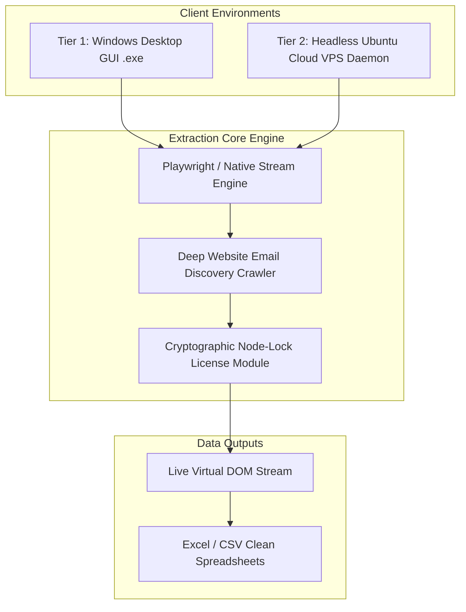

# WikiFint LeadRadar Pro — Zero-API-Cost B2B Google Maps Scraper & Deep Email Discovery Suite

[-emerald?style=for-the-badge&logo=google-cloud&logoColor=white)](#why-wikifint-leadradar)

> **Tired of paying $100+/mo for Apify, PhantomBuster, or Google Cloud API credits?**  
> **WikiFint LeadRadar Pro** is a high-performance, self-hosted B2B Google Maps lead extraction engine that runs 100% client-side with **ZERO API fees**. Extract unlimited verified business records, direct phone numbers, authentic 19-digit Google CIDs, and deep-crawled contact emails across 19+ countries in seconds.

---

### 🌐 Try the Interactive Web Demo (No Signup Required)
Experience the speed and data structure before downloading:  
👉 **[https://leadradar.wikifint.com](https://leadradar.wikifint.com)** *(4 Free Live Test Runs Included)*

---

## ⚡ Why WikiFint LeadRadar Outperforms Competitors

| Feature | Standard Apify / Outscraper | Cheap Chrome Extensions | WikiFint LeadRadar Pro |
| :--- | :---: | :---: | :---: |
| **API Costs** | $5 – $15 per 1k leads | Free / Hidden limits | 🟢 **$0.00 (Zero API Fees Forever)** |
| **Monthly Subscription** | $49 – $199 / month | $19 – $49 / month | 🟢 **Lifetime One-Time Purchase** |
| **Email Discovery** | Extra fee per email | ❌ Missing (Phone only) | 🟢 **Built-in Deep Website Crawler** |
| **System Stability** | Cloud Queue lag | ❌ Freezes browser after 200 leads | 🟢 **Compiled 64-Bit Virtual DOM** |
| **24/7 Cloud Scaling** | High server bill | ❌ Impossible (Requires browser) | 🟢 **Headless Ubuntu VPS Daemon** |
| **Data Privacy** | Stored on 3rd party servers | Browser history exposed | 🟢 **100% Client-Side Private Storage** |

---

## 💎 Key Features

- **Zero Google API Bills:** Bypasses expensive Google Cloud Platform fees using headless DOM streaming.
- **Deep Website Email Discovery:** Automatically scrapes company websites for direct decision-maker emails (`admin@`, `info@`, `bookings@`, `reception@`, `dr.smith@...`).
- **Nationwide Bulk Mining:** 1-Click extraction across 25–30 major metropolitan hubs simultaneously.
- **Authentic 19-Digit Google Maps Customer IDs (CID):** Verifiable numerical CID format (`1250409851944524724`) for deduplication and CRM enrichment.
- **19+ Worldwide Supported Markets:** United States, United Kingdom, Australia, Canada, United Arab Emirates, Saudi Arabia, Qatar, Germany, France, Italy, India, Singapore & more.
- **Smooth Virtual Table Buffer:** Renders streaming rows with zero memory lag or browser crashes.
- **Instant Spreadsheet Export:** Download clean `.csv` and `.xlsx` ready for cold email outreach (Instantly, Smartlead, Lemlist).

---

## 🏗️ Architecture & Dual-Tier Editions

### 1. Tier 1: Windows Desktop Portable Edition
- Single portable `.exe` (No Python or complex setup required).
- Built-in automatic browser dashboard launcher at `http://localhost:8501`.
- Ideal for solo marketers, freelancers, and sales reps.

### 2. Tier 2: 24/7 Headless Linux VPS Daemon
- Deploy onto an inexpensive ($4–$6/mo) Ubuntu 22.04 LTS Cloud VPS (Hetzner, DigitalOcean, Contabo).
- Runs 24/7 continuously in the background mining millions of records without keeping your personal laptop awake.

---

## 🚀 How It Works (Download & Setup)

1. Get your lifetime license key from the official store.
2. Download the latest compiled client package:
   👉 **[Download WikiFint LeadRadar Latest Client](https://leadradar.wikifint.com/download/latest)**
3. Extract the `.zip` archive on your Windows computer or Ubuntu server.
4. Launch `WikiFint_LeadRadar_Pro.exe` (or run daemon on Ubuntu).
5. Enter your license key to unlock unlimited, zero-cost Google Maps lead extraction.

---

## 📦 Data Schema in Exported Spreadsheets

Every extracted record includes:
- **`Company`**: Official business title (e.g. *Oasis Dental Studio of Sydney*)
- **`Category`**: Target industry / niche (e.g. *Dental Clinic*, *Real Estate Agency*)
- **`Email`**: Deep-crawled contact email
- **`Phone`**: Formatted telephone number with national/area dialing codes
- **`Website`**: Clean verified business website URL
- **`Address`**: Physical street address and postal sector
- **`City`**: Target metropolitan hub
- **`Review`**: Google Maps star rating score (e.g. *4.8*)
- **`Rating`**: Total number of customer reviews
- **`Cid`**: Authentic 19-digit Google Maps Customer ID

---

## 🛒 Commercial Pricing & Purchasing

| Edition | Price | Target Audience | Workstations |
| :--- | :---: | :--- | :---: |
| **Solo Marketer** | **$49** | Solo Marketers & Freelancers | 1 Node-Locked PC |
| **Agency Growth** | **$99** | Agencies & Lead Gen Teams | Up to 3 Workstations |
| **Enterprise Cloud** | **$199** | Massive 24/7 Mining Teams | Windows GUI + Ubuntu VPS Daemon |

👉 **Purchase Instant Lifetime License:** [https://wikifint.com](https://wikifint.com) *(Instant Key & Software Delivery)*

---

## 📞 Support & Community

- **Official Website:** [wikifint.com](https://wikifint.com)
- **Live Demo:** [leadradar.wikifint.com](https://leadradar.wikifint.com)
- **Email Support:** [admin@wikifint.com](mailto:admin@wikifint.com)
- **Built & Maintained by:** WikiFint Developer Team

---
*© 2026 WikiFint LeadRadar. All Rights Reserved. Zero API Fees. Self-Hosted B2B Intelligence.*
